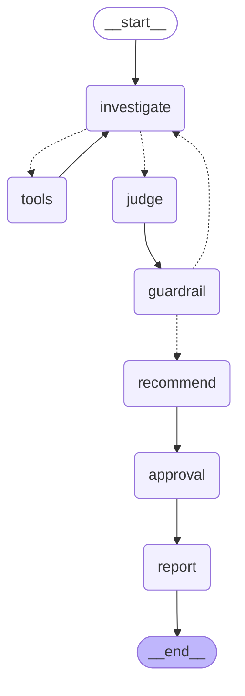

# 아키텍처

> 1일차에 화이트보드로 함께 그린 설계도를 옮깁니다. 출발점은 01 문서 5장의 그림(①~⑤)과 01b 문서의 부품 표입니다.

## 1. 에이전트 설계도
<!-- python -m soc.agent.graph 출력(Mermaid)을 붙이고, 아래 표를 채우기 -->

점선은 갈림길(조건에 따라 한쪽으로), 실선은 항상 가는 길입니다.

| 노드 | 하는 일 | 읽는 상태 | 쓰는 상태 | 쓰는 도구 | 운전 |
|---|---|---|---|---|---|
| 조사 | LLM이 알림과 지금까지의 대화를 보고 어떤 조사 도구를 부를지 정함. 다 모았으면 "조사 완료" | `alert`, `messages` | `messages`(첫 호출이면 알림 메시지 + LLM 응답), `trace`, `usage` | 🔍 조사 도구 | 📘 |
| 도구 실행 | LLM이 요청한 도구를 실제로 실행하고, 결과에 나온 `event_id`를 모음 | `messages`(마지막 응답의 도구 요청), `tool_rounds` | `messages`(도구 결과), `seen_event_ids`, `tool_rounds`(+1), `trace` | 🔍 조사 도구 | |
| 판정 | 조사 대화를 보고 악성 / 의심 / 정상을 `Verdict` 형식으로 답함 | `messages` | `verdict`, `trace`, `usage` | 없음 | |
| 가드레일 | 판정의 근거 id가 실제로 조회한 기록인지 검사. 실패하면 다시 조사시키거나 '의심'으로 낮춤 (검사 내용은 2일차 G-1, G-2) | `verdict`, `seen_event_ids`, `alert`, `guardrail_retries` | `guardrail`, `guardrail_log`, `trace`, 실패 시 `guardrail_retries`와 `messages` 또는 낮춘 `verdict` | 없음 | 📘 |
| 권고 | 알림 제목과 판정 기법으로 플레이북을 검색하고, LLM이 조치를 `Recommendation` 형식으로 권고 | `verdict`, `alert` | `playbook`, `recommendation`, `trace`, `usage` | 📘 플레이북 검색 | 🔍 |
| 승인 | 위험한 조치가 있으면 `interrupt()`로 멈추고 승인 요청(호스트, 판정과 신뢰도, 기법, 근거 id, 승인할 조치와 승인권자)을 넘김. 재개되면 결정(`approved`, `approver`, `comment`)을 기록. 위험한 조치가 없으면 `not_required`로 통과 (H-1, 11-19 김진홍) | `recommendation`, `verdict`, `alert` | `approval`, `trace` | 없음 | 🔍 |
| 리포트 | 판정, 근거, 권고, 출처, 승인 결과, 비용을 한 장으로 정리 | `alert`, `verdict`, `guardrail`, `guardrail_log`, `recommendation`, `playbook`, `approval`, `tool_rounds`, `usage`, `trace` | `report`, `trace` | 없음 | |

## 2. 갈림길
<!-- 도구는 최대 몇 번 부르나? 가드레일이 실패하면? 승인은 언제 요청하나? -->

| 갈림길 | 조건 | 가는 곳 |
|---|---|---|
| 조사 뒤 (`after_investigate`) | LLM 응답에 도구 요청이 있고 `tool_rounds`가 6(`MAX_TOOL_ROUNDS`) 미만 | 도구 실행. 아니면 판정 |
| 가드레일 뒤 (`after_guardrail`) | 검사 실패 + 다시 조사하라는 메시지가 붙어 있음 (`GUARDRAIL_ON_FAIL=retry`, 최대 1번) | 조사. 아니면 권고 (재시도가 끝났으면 '의심'으로 낮춘 채로) |
| 승인 (2일차) | 권고에 `block_ip`, `kill_process`, `isolate_host`, `reset_password` 중 하나가 있음 | 멈추고 사람 승인 대기. 없으면 바로 리포트 |

- 도구 횟수에 상한(6번)을 둔 이유: LLM이 도구를 끝없이 부르면 비용과 시간이 늘기 때문.
- 가드레일 실패 시 `retry`와 `downgrade` 중 무엇을 쓸지는 2일차 D2-3에서 둘이 정함. 지금은 기본값 `retry`.

## 3. 배포 구성도 (2일차부터)
<!-- 01b 문서 2장의 그림을 실제 리소스(Deployment, StatefulSet, Job, Service, Ingress, Secret, ConfigMap)로 바꿔 그리기 -->
